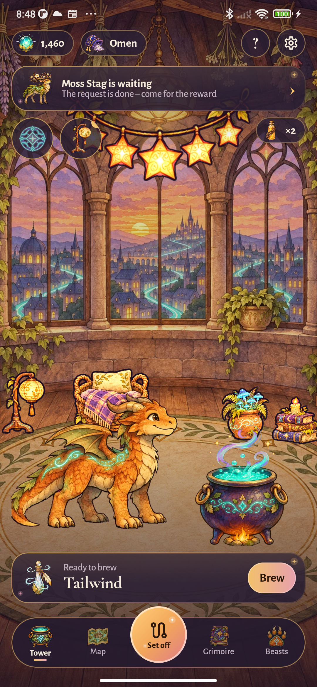
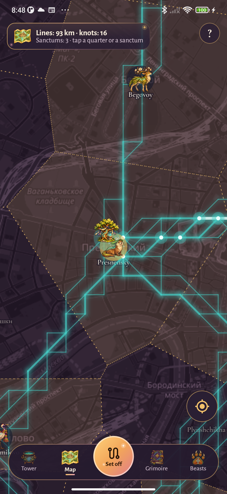
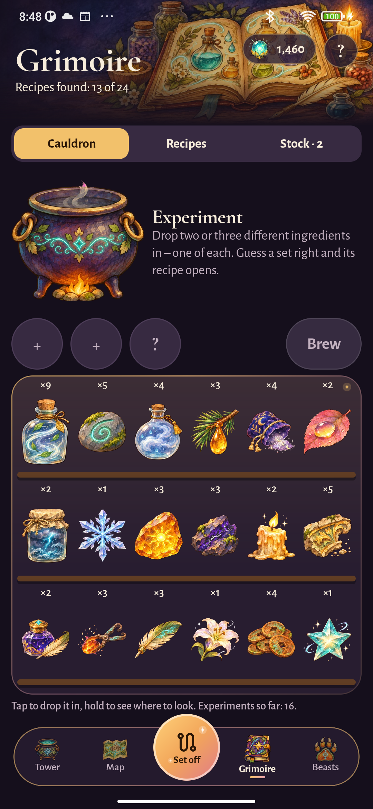
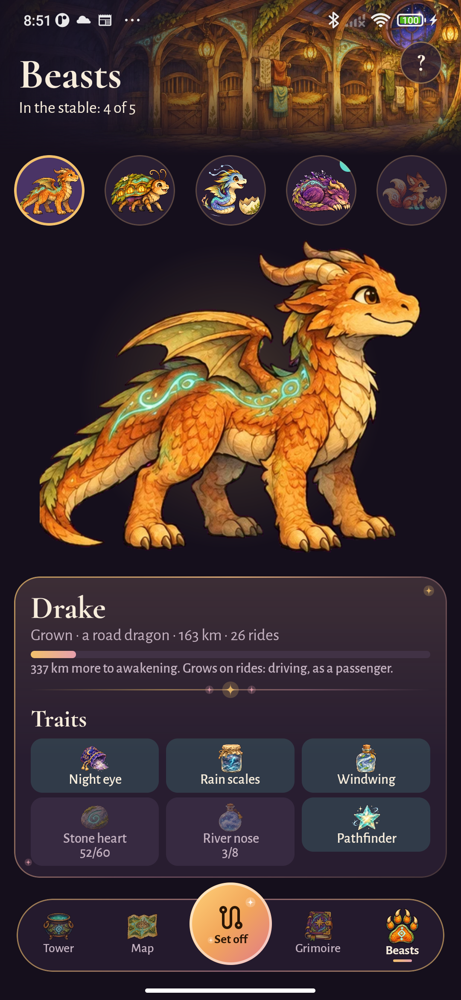
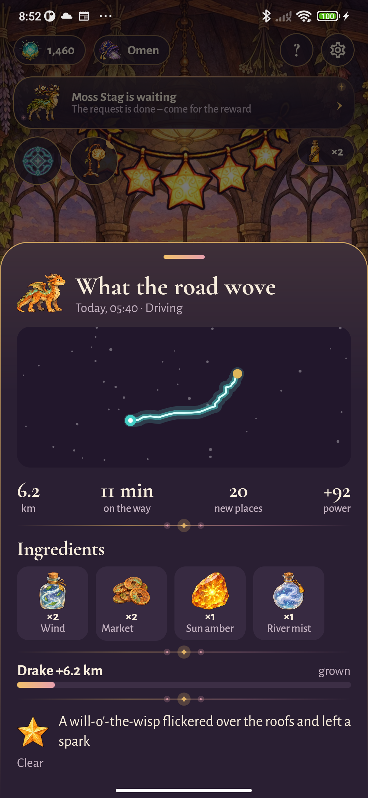
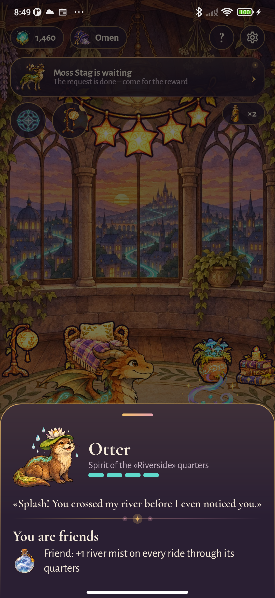
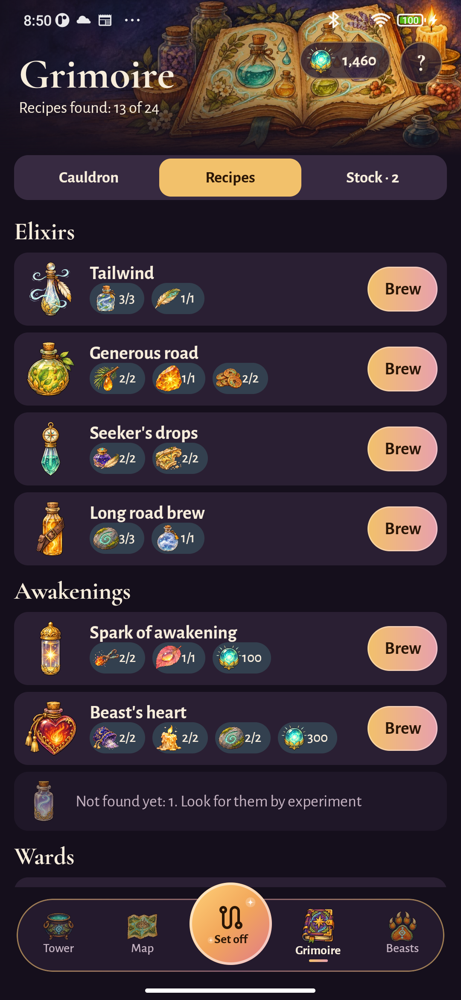
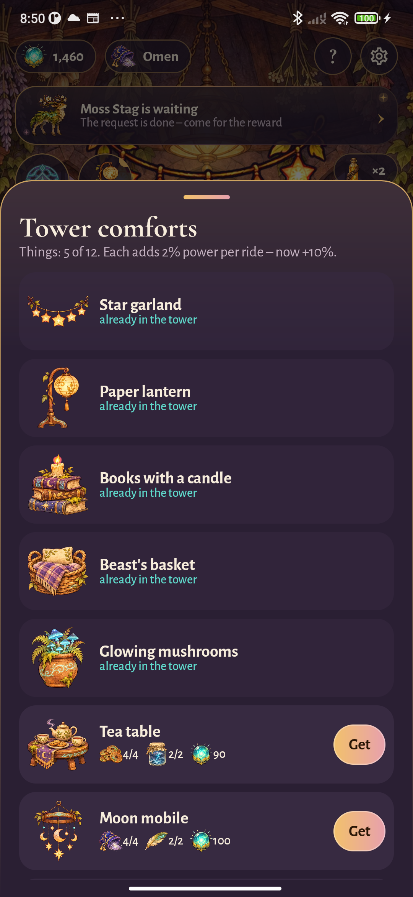

<p align="center"></p>

<h1 align="center">Leyline</h1>

<p align="center">Ride around your city as usual – and the road brings you ingredients for potions.<br>
<a href="https://bigdevwhale.github.io/stillcraft/apps/leyline/">Website</a> · <a href="https://github.com/bigdevwhale/leyline/releases/latest/download/Leyline.apk">Download APK</a> · <a href="README.ru.md">Русский</a></p>

Under the streets of your city run hidden lines of power. Every ride – by car, bus, tram, underground or bike – lights a glowing path along them, and whatever the way offered goes into your bag: mist from the river, resin from the park, copper from the market, moonlight after midnight. Back home in your tower you brew potions from it. Nobody hands you the recipes – you find them by dropping ingredients into the cauldron.

<p align="center">




</p>

## What's inside

- **Ingredients from the real road.** There are eighteen. A fast road brings wind, traffic jams bring stone, the weather brings storm and frost, the night brings moonlight, twilight brings dawn, the underground brings ore, and places you have never been bring star shards. The rest depends on what lay along the route – a river, a park, old streets, a university, a market, a station – read from OpenStreetMap.
- **The cauldron and experiments.** Drop in two or three different ingredients. Guess the set and its recipe opens; miss, and the cauldron tells you warm or cold. Twenty-four recipes in all: elixirs for the next rides, awakenings for your beasts, wards, gifts for spirits and three wonders.
- **A beast for every ride.** A road dragon for the car, a lantern beetle for the bus, a spark serpent for the tram, a burrow wyrm for the underground and a two-tailed fox for the bike. Beasts grow with the kilometres, from baby to ancient, when you brew them an awakening potion. How you ride gives them traits – night eye, rain scales and more.
- **The map of power.** The city is cut into 250 m cells. The route you ride most grows from a thin trail into a great line, and where three strong paths meet a knot forms. The underground shows as dashes below ground.
- **Quarters and their spirits.** The districts are real, from OpenStreetMap, and each has a kind: gardens, riverside, old town, forges, market. Each has a spirit – an otter by the river, a candle owl in the old lanes, a trader magpie at the market. A spirit has four requests; do them all and it becomes your friend and gives an ingredient on every ride through its quarters.
- **Sanctums.** Places where your rides often begin and end – home, work, a friend's – awaken after three visits. You can set a ward on them.
- **Every day a little different.** The omen of the day from the sun and moon, the blooming quarter of the week, the full moon, the Wild Hunt. And now and then a surprise on the road: a golden vein, a will-o'-the-wisp, a meteor.
- **A cosy tower.** Twelve things for your room – a star garland, a paper lantern, a tea table, a telescope. Each shows in the tower and adds power.
- **Nothing to tap while driving.** While the car moves, the screen shows only what matters, and everything gathered waits for you when you park. When the phone connects to your car, a «Your drake is ready» notification comes. For the bus and the underground there's a quick-settings tile.
- No penalties: a missed day takes nothing away. Light and dark themes, Russian and English.

<p align="center">




</p>

## Install

Download [Leyline.apk](https://github.com/bigdevwhale/leyline/releases/latest/download/Leyline.apk) to a phone with Android 9 or newer, open it and allow the install when Android asks.

## Privacy

No ads, no accounts, no analytics. Your rides and all your progress stay on your phone. Location is read only while the app is open or a ride is on, with a notification on screen. The only things that go online are requests for map tiles, the weather and OpenStreetMap data – with coordinates, but nothing about you. See [PRIVACY.md](PRIVACY.md).

## Build

You need JDK 17+ (Android Studio's JBR will do) and the Android SDK.

```
./gradlew assembleDebug
./gradlew assembleDebug -Pdemo -Pdemolang=en   # app.leyline.demo: a few weeks of play in central Moscow
./gradlew testDebugUnitTest
```

Kotlin, Jetpack Compose, osmdroid. The beasts, spirits, ingredients, potions and scenes were drawn with image generation (`tools/gen_art.py`, `tools/cut.py`).

## License

MIT, see [LICENSE](LICENSE).

Leyline is one of the [StillCraft](https://bigdevwhale.github.io/stillcraft/) apps.
