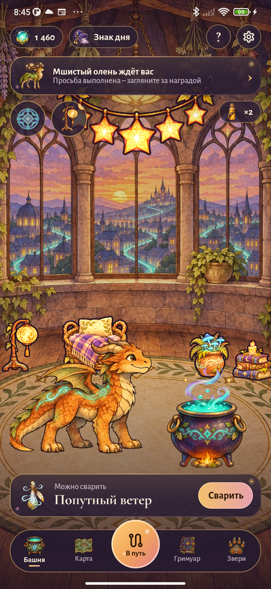
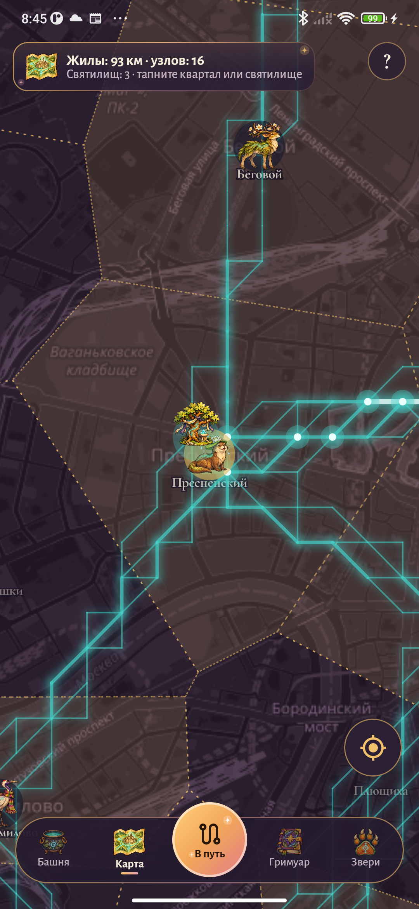
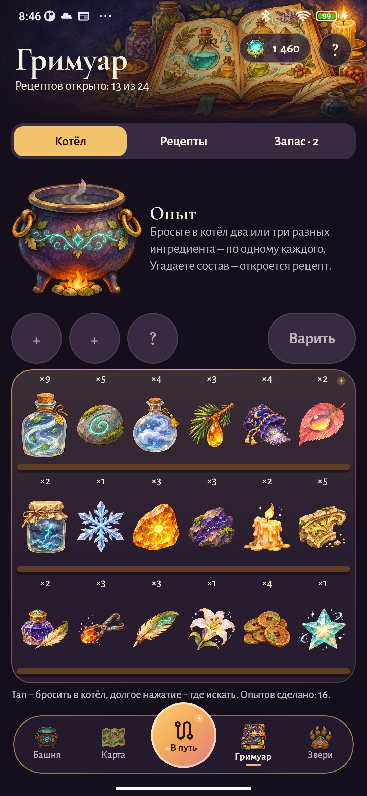
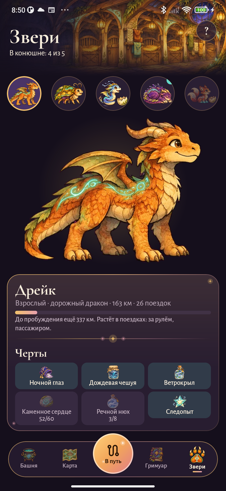
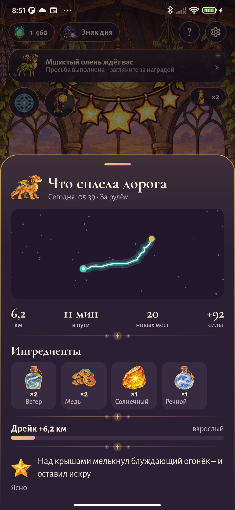
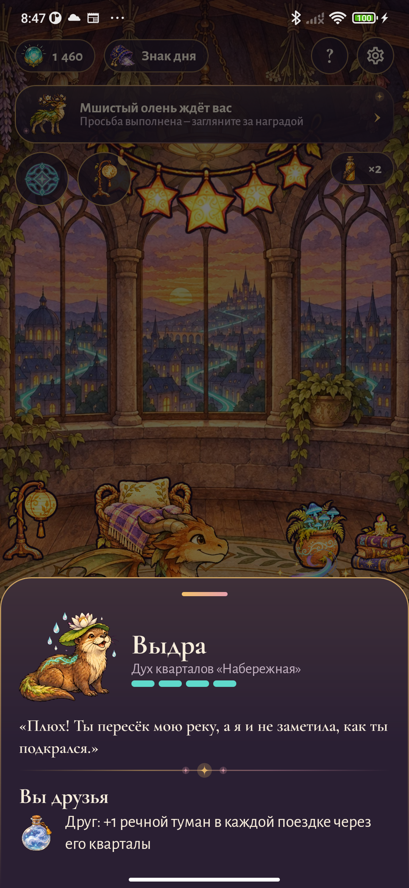
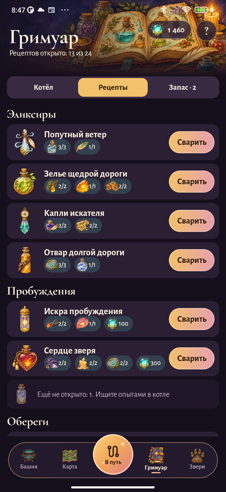
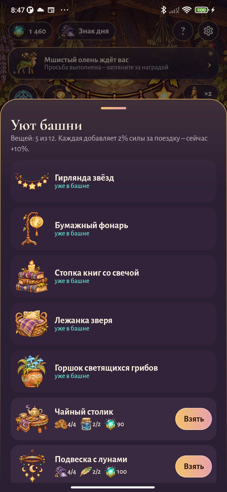

<p align="center"></p>

<h1 align="center">Тропы силы</h1>

<p align="center">Ездите по городу как обычно – а дорога приносит ингредиенты для зелий.<br>
<a href="https://bigdevwhale.github.io/stillcraft/apps/leyline/">Сайт</a> · <a href="https://github.com/bigdevwhale/leyline/releases/latest/download/Leyline.apk">Скачать APK</a> · <a href="README.md">English</a></p>

Под улицами вашего города текут невидимые жилы силы. Каждая поездка – на машине, автобусе, трамвае, метро или велосипеде – прокладывает по ним светящуюся тропу, а в котомку попадает то, что встретилось в пути: туман с реки, смола из парка, медь с рынка, лунный свет после полуночи. Дома, в башне, из этого варят зелья. Рецептов никто не даёт – их угадывают, бросая ингредиенты в котёл.

<p align="center">




</p>

## Что внутри

- **Ингредиенты из настоящей дороги.** Их восемнадцать. Ветер приносит быстрая дорога, камень – пробки, грозу и иней – погода, лунный свет – ночь, зарю – сумерки, рудную пыль – метро, звёздные осколки – места, где вы ещё не бывали. Остальное зависит от того, что было вдоль маршрута: река, парк, старые улицы, университет, рынок, вокзал. Это берётся из OpenStreetMap.
- **Котёл и опыты.** Бросьте два-три разных ингредиента. Если угадали состав – откроется рецепт. Если нет, котёл подскажет, тепло или холодно. Всего двадцать четыре рецепта: эликсиры на следующие поездки, пробуждения для зверей, обереги, дары духам и три чуда.
- **Свой зверь для каждого транспорта.** Дорожный дракон для машины, жук с фонариками для автобуса, искрозмей для трамвая, подземный червь для метро и двухвостый лис для велосипеда. Звери растут с километрами: из детёныша в древнего, если сварить им зелье пробуждения. По тому, как вы ездите, у зверя появляются черты – ночной глаз, дождевая чешуя и другие.
- **Карта силы.** Город поделён на клетки по 250 метров. Маршрут, по которому вы ездите чаще всего, из тонкой тропки становится великой жилой, а там, где сходятся три сильные тропы, завязывается узел. Метро рисуется пунктиром под землёй.
- **Кварталы и их духи.** Районы города – настоящие, из OpenStreetMap, и у каждого свой вид: сады, набережная, старый город, кузни, торжище. В каждом живёт дух: выдра у реки, сова-свечница в старых переулках, сорока-меняла на рынке. У духа четыре просьбы – выполните их, и он станет другом и будет дарить ингредиент в каждой поездке через его кварталы.
- **Святилища.** Места, где поездки часто начинаются и заканчиваются – дом, работа, дача, – после трёх визитов пробуждаются. На них можно поставить оберег.
- **Каждый день немного разный.** Знак дня по солнцу и луне, квартал недели, где всё цветёт, полнолуние, Дикая охота. А в дороге иногда случается сюрприз: золотая жила, блуждающий огонёк, метеор.
- **Уютная башня.** Двенадцать вещей для комнаты – гирлянда звёзд, бумажный фонарь, чайный столик, телескоп. Каждая видна в башне и прибавляет силы.
- **За рулём ничего нажимать не нужно.** Пока машина едет, на экране только самое главное, а всё собранное ждёт вас после стоянки. Телефон подключился к машине – приходит уведомление «Дрейк готов в путь». Для автобуса и метро есть плитка в шторке быстрых настроек.
- Без штрафов: пропущенный день ничего не отнимает. Светлая и тёмная темы, русский и английский.

<p align="center">




</p>

## Установка

Скачайте [Leyline.apk](https://github.com/bigdevwhale/leyline/releases/latest/download/Leyline.apk) на телефон с Android 9 или новее, откройте файл и разрешите установку, когда Android спросит.

## Конфиденциальность

Без рекламы, аккаунтов и аналитики. Поездки и весь прогресс хранятся только на телефоне. Местоположение приложение берёт, только когда оно открыто или идёт поездка – тогда на экране висит уведомление. В сеть уходят лишь запросы плиток карты, погоды и данных OpenStreetMap – с координатами, но без каких-либо сведений о вас. Подробнее – в [PRIVACY.md](PRIVACY.md).

## Сборка

Нужны JDK 17+ (подойдёт JBR из Android Studio) и Android SDK.

```
./gradlew assembleDebug
./gradlew assembleDebug -Pdemo -Pdemolang=ru   # app.leyline.demo: несколько недель игры в центре Москвы
./gradlew testDebugUnitTest
```

Kotlin, Jetpack Compose, osmdroid. Звери, духи, ингредиенты, зелья и сцены нарисованы с помощью генерации изображений (`tools/gen_art.py`, `tools/cut.py`).

## Лицензия

MIT, см. [LICENSE](LICENSE).

Тропы силы – одно из приложений [StillCraft](https://bigdevwhale.github.io/stillcraft/).
